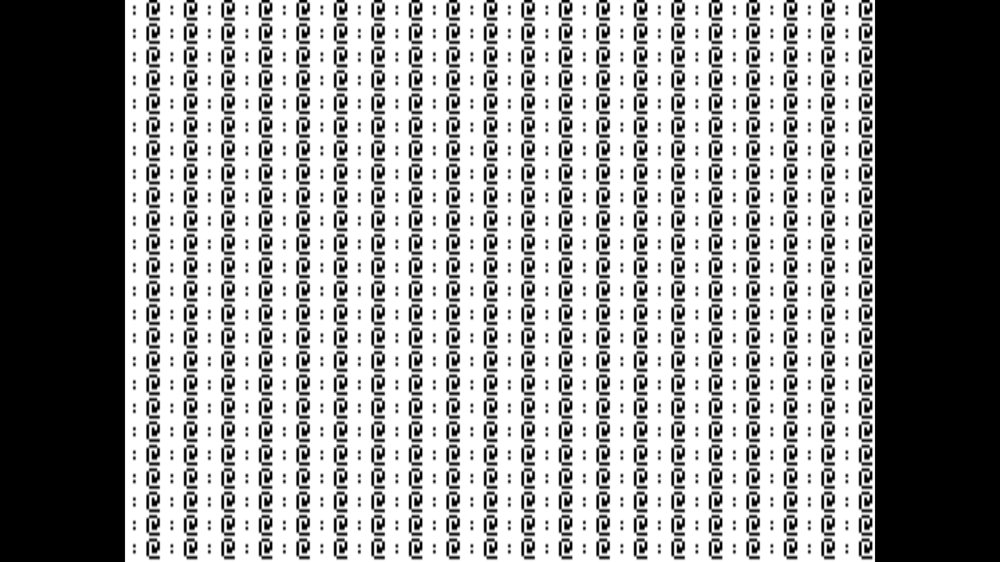

# ALS The CP/M Card for MAME and AppleWin

[한국어](README.md) | [English](README.en.md)

This repository provides the changes needed to add the ALS The CP/M Card to MAME's Apple II bus and to AppleWin, along with CP/M disk images and reference documents. The two ports are independent (MAME: `src/`, `patches/`; AppleWin: `applewin/`). Neither emulator's full source tree is included.

## Contents

- `src/devices/bus/a2bus/a2cpmcard.cpp` and `a2cpmcard.h`: the 6 MHz Z80B card, onboard RAM, Apple II memory and DMA access, bank switching, and slot control
- `src/lib/formats/fdi_dsk.cpp`: a wrapper that reuses MAME's PC-98 FDI format implementation
- `patches/mame-cpmcard.patch`: adds the card files to MAME's build, registers the card in Apple II slots, and adds `/IRQ` change notification to the a2bus (`a2bus.cpp/.h`, `bus_irq_w()`)
- `patches/mame-apple2e-backspace.patch`: fixes Apple IIe Backspace input
- `CPM/`: CP/M disk images and card reference documents
- `screenshots/cpm-card-boot.png`: a complete CP/M startup screen with the card installed
- `photos/`: photos of a real card (component and solder side scans plus close-ups)
- `applewin/applewin-cpmcard.patch`, `applewin/source/ALSCPMCard.cpp` and `ALSCPMCard.h`: the AppleWin port (see "Apply to AppleWin and build")

## Apply the patches and build MAME

These changes are based on MAME commit `84981cc15cfc1429e48f098d80c6dd97bc82a0bc`. Clone MAME and this repository into sibling directories, then apply both patches from the MAME checkout:

```bash
git clone https://github.com/mamedev/mame.git
git clone https://github.com/mildstorm/TheCPMCard.git
cd mame
git checkout 84981cc15cfc1429e48f098d80c6dd97bc82a0bc
git apply ../TheCPMCard/patches/mame-cpmcard.patch
git apply ../TheCPMCard/patches/mame-apple2e-backspace.patch
```

The Backspace patch maps the Apple IIe Delete key, which is bound to the host Backspace key, to ASCII Backspace (`0x08`) so CP/M command-line editing works as expected.

Build the Apple IIe target from the MAME source directory:

```bash
make -j$(nproc) SUBTARGET=apple2e SOURCES=src/mame/apple/apple2e.cpp REGENIE=1
```

See the [MAME compilation guide](https://docs.mamedev.org/initialsetup/compilingmame.html) for platform-specific prerequisites and build instructions.

## Apply to AppleWin and build

Based on AppleWin commit `4a43bcdb` (upstream master). The patch carries the new `source/ALSCPMCard.{h,cpp}` and the card registration, command line, VS project and help changes. `applewin/source/` holds a copy of the same card sources.

```bash
git clone https://github.com/AppleWin/AppleWin.git
cd AppleWin
git checkout 4a43bcdb
git am ../TheCPMCard/applewin/applewin-cpmcard.patch
```

Build `AppleWin-VS2026.vcxproj` as Release/Win32 with Visual Studio 2026. Without the VS2022 build tools (v143), override the toolset so the library sub-projects build too:

```bash
MSBuild AppleWin-VS2026.vcxproj /p:Configuration=Release /p:Platform=Win32 /p:PlatformToolset=v145
```

To run, choose "ALS CP/M Card" in a slot in the configuration dialog, or use the command line. At the startup menu press `4` for the `A>` prompt.

```bash
Release\AppleWin.exe -s5 cpmcard -d1 "..\TheCPMCard\CPM\CPM.Disk1.DSK"
```

- It cannot be fitted together with a Microsoft Z-80 SoftCard (`-sN z80` or `-sN softcard`): one Z80 card at a time.
- Implementation: AppleWin's single Z80 (the VICE core) gains a board hook (`Z80Board`). Through it the card supplies the memory, I/O, the clock (6 MHz in bank 1 with the M1 stretch, 3 MHz in bank 0) and a level `/INT` (IM 0/1/2). Without a board the SoftCard behaves as before.
- AppleWin runs one CPU at a time, so the Z80 does not run on from its own RAM while the 6502 has the bus. CP/M Plus 3.01C always hands the bus over from Apple memory, so the result is the same.
- Verified: CP/M Plus 3.01C boots, and `DIR` and `DATE` (running clock) work. Microsoft CP/M 2.20B on the SoftCard is unchanged.

## Run CP/M (MAME)

Install the ALS CP/M card in any free slot and a 5.25-inch Disk II controller in slot 6. The boot code finds the card's slot itself; booting was verified with the card in slots 1, 4, 5 and 7. **Do not fit a Microsoft Z-80 SoftCard at the same time** (see "Boot process" below). The command below keeps the default slot 6 Disk II controller, puts the CP/M card in slot 4, and mounts the CP/M Plus system disk and GSX-80 D1 disk in the first two drives.

Run it from the MAME source directory. This example assumes the MAME and TheCPMCard repositories are sibling directories:

```bash
./apple2e.exe apple2e -window -nomaximize -sl4 cpmcard \
  -flop1 "../TheCPMCard/CPM/CPM.Disk1.DSK" \
  -flop2 "../TheCPMCard/CPM/GSX-80 VERSION 1.1/GSX80D1.DSK"
```

MAME defaults to full-screen mode. `-window -nomaximize` opens it in a smaller window; drag a window edge to resize it.

At the startup menu, press `4` to reach the `A>` prompt. Pressing the host Backspace key removes the previous character.

## Screenshot

The image below shows the complete CP/M Plus 3.01C startup menu:



## Hardware model

The emulation follows photos of a real board (PCB "DIGITAL RESEARCH / Advanced Logic Systems", 08-83) and `CPM/CPM Card Schematic.pdf` (rev A, 05-04-83).

| Part | Function |
|------|----------|
| U15 Z0840006PSC | Z80B, 12 MHz crystal (Y1) / 2 = 6 MHz |
| U2-U5, U7-U10 M5K4164S-15 | 8 × 64K×1 DRAM = 64K card RAM |
| U26 Raytheon R29623 (20-pin bipolar PROM) | Z80 → Apple address translation, one entry per 256-byte page |
| U22 74S113 | 6502/Z80 bus ownership toggle + Z80 clock divider |
| U6 74LS74 | M1 clock stretch (DRAM timing) |
| U27 74LS74 | Bank latch + 62 Hz tick flip-flop |
| U1 4020 | Apple Φ1 / 2^14 ≈ 62 Hz real-time-clock tick |

Component side: [photos/Scan_20261112_233251.jpg](photos/Scan_20261112_233251.jpg), solder side: [photos/Scan_20261112_233343.jpg](photos/Scan_20261112_233343.jpg)

The card has **no firmware ROM**; everything is loaded from disk by the 6502. The only programmable part is the U26 PROM, which has not been dumped yet.

- **Hand-off**: every write to `$Cnxx` (from the 6502, or from the Z80 through DMA) toggles bus ownership, and the card asserts /DMA while the Z80 owns the bus. The Z80 is never stopped as a whole: /WAIT is asserted only when it accesses Apple memory while the 6502 owns the bus, so it can keep running from card DRAM in parallel with the 6502 (emulated with MAME's restartable memory access). Reads of `$Cnxx` are not decoded (open bus).
- **Bank latch (U27)**: D0 is latched on every Z80 I/O write; the port address is not decoded. The CP/M 3 BIOS writes `F0` (bank 0) / `FF` (bank 1) to port 00. Z80 I/O reads return D0 = Apple /IRQ, D1-D7 = 1.
- **Memory map**: in bank 0 (reset state) Z80 `$0000-$EFFF` goes to Apple memory through U26. The table is synthesized as Z80 + `$9000` with the `$Cxxx`/`$Fxxx` pages swapped (Z80 `$0000-$2FFF` → `$9000-$BFFF`, `$3000` → `$F000`, `$4000-$5FFF` → `$D000-$EFFF`, `$6000` → `$C000` I/O, `$7000-$EFFF` → `$0000-$7FFF`). The PROM sees Z80 A15 inverted. In bank 1, `$0000-$EFFF` is card DRAM. `$F000-$FFFF` is card DRAM in both banks.
- **Real-time clock**: U1 divides Apple Φ1 by 2^14 (≈62.3 Hz). Z80 /INT = tick pending OR Apple /IRQ (slot pin 30). Interrupt acknowledge clears the tick and puts `$F7` (`RST 30h` in IM 0) on the bus. The 3.01C BIOS clock handler at `$FB94` counts 60 ticks per second, so `DATE` shows a running clock that is about 4% fast, as on the real card.
- **Z80 clock**: in bank 1 U6 removes one 12 MHz pulse per opcode fetch (M1 = 4.5 T-states, emulated as one extra T-state every second fetch). In bank 0 the divider only runs while Apple Φ0 is high, which is exactly 50% of every Apple cycle, so the Z80 averages 3 MHz (0.5 clock scale; the two crystals are not phase-locked).

## Boot process

Found by disassembling the CP/M Plus 3.01C boot disk (`CPM.Disk1.DSK`). Another emulator has to reproduce this sequence.

1. The Disk II boot ROM reads the loader on track 0 into `$0800`. `$08FE` = `$00` (found flag) and `$08FF` = `$C7` (slot under test).
2. The loader (`$092A`) writes `STA $Cn00` for slots 7 down to 1 and checks `$08FE` after each. It decrements the `$Cn00` operand and `$08FF` together. With no ROM, this write is the only way to find the card.
3. The card that receives the write takes the bus, and its Z80 runs from `$0000` (Apple `$9000`), straight out of reset:
   - It reads Apple `$E000` (language card), inverts the byte, writes it back and compares. It only continues if language card RAM could not be written.
   - It reads its slot from `$08FF`, stores it at `$03CA`, and sets `$08FE` = `$FF` to report that it was found.
   - It writes `$Cn00` to give the bus back to the 6502.
4. The 6502 sees `$08FE` ≠ 0, jumps to `$0970` and loads CP/M.

What follows from this:

- **No SoftCard alongside**: Microsoft CP/M finds its SoftCard the same way (a write to each slot's `$Cn00`), so each CP/M wakes the other card. With both cards fitted in MAME, Microsoft CP/M hangs.
- **The Z80 must start at `$0000`**: a Z80 that leaves reset anywhere else (for example taking a stale pending NMI to `$0066`) skips step 3. It then hands the bus to the default slot 4 (`$C400`) and hangs. MAME's Z80 clears a pending NMI on reset, so this cannot happen here. When porting to another Z80 core, check that its reset clears a pending NMI.
- **The 6502 must stop right after its `$Cn00` write**: one more instruction decrements `$08FF`, and the Z80 hands the bus to the wrong slot.

## Disk images and reference documents

The `CPM/` directory includes CP/M 2.2 and CP/M Plus disks, a ProDOS disk, and reference PDFs for the card. Some disk images and documents may be third-party works; check the applicable rights and licenses before using or distributing them.
