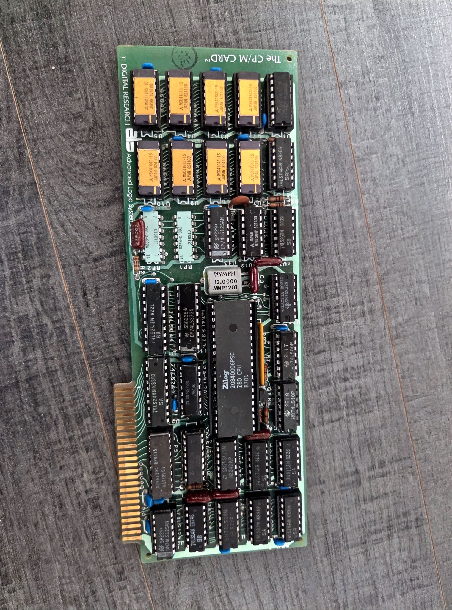
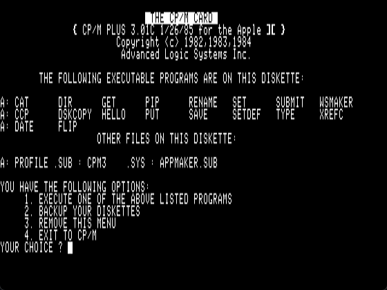
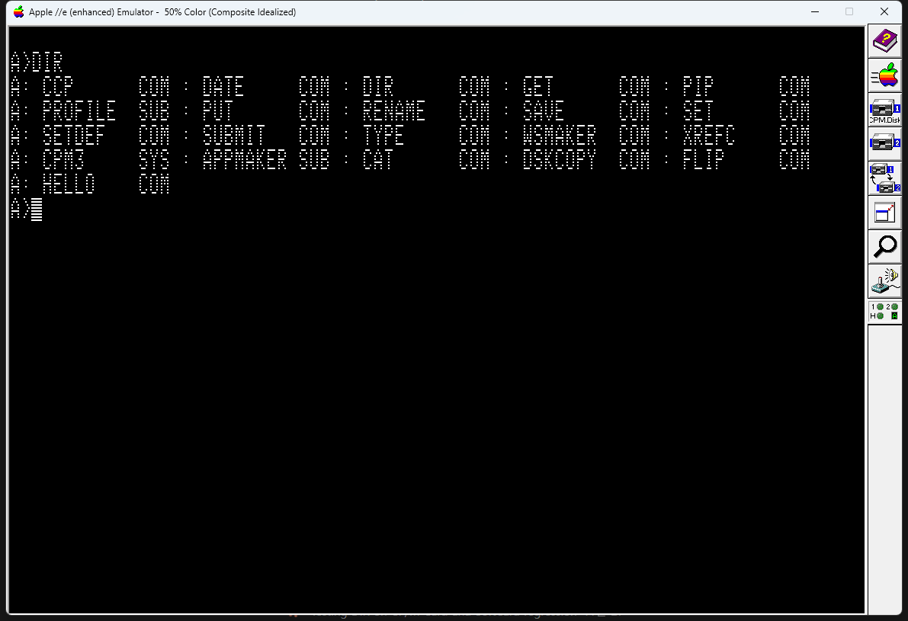

# ALS The CP/M Card for MAME and AppleWin

[한국어](README.md) | [English](README.en.md)

<p align="center">
  <br>
  <em>Advanced Logic Systems "The CP/M Card" — Apple II용 Z80B 6 MHz + 64K CP/M 카드 (PCB 08-83)</em>
</p>

이 저장소는 ALS The CP/M Card를 MAME와 AppleWin에 추가하는 변경 사항, CP/M 디스크 이미지 및 참고 문서를 제공합니다. 두 포팅은 서로 독립적이며 폴더로 나뉘어 있습니다. 각 에뮬레이터의 전체 소스는 포함하지 않습니다.

## 폴더 구성

| 폴더 | 대상 | 내용 |
|------|------|------|
| `mame/` | MAME | 카드 소스와 MAME 패치, 실행 화면 |
| `applewin/` | AppleWin | 카드 소스와 AppleWin 패치, 실행 화면 |
| `CPM/` | 공통 | CP/M 디스크 이미지와 카드 참고 문서(회로도 PDF 등) |
| `photos/` | 공통 | 실제 카드 사진(부품면·납땜면 스캔과 부분 확대 사진) |

**MAME (`mame/`)**

- `mame/src/devices/bus/a2bus/a2cpmcard.cpp`, `a2cpmcard.h`: 6 MHz Z80B, 카드 RAM, Apple II 메모리/DMA 연결, 뱅크 전환 및 슬롯 제어 구현
- `mame/src/lib/formats/fdi_dsk.cpp`: MAME의 PC-98 FDI 포맷 구현을 재사용하는 래퍼
- `mame/patches/mame-cpmcard.patch`: 새 파일과 MAME 빌드 목록/Apple II 슬롯 등록, a2bus의 `/IRQ` 변화 통지(`a2bus.cpp/.h`, `bus_irq_w()`)를 적용하는 패치
- `mame/patches/mame-apple2e-backspace.patch`: Apple IIe Backspace 수정 패치
- `mame/screenshots/cpm-card-boot.png`: MAME 실행 화면

**AppleWin (`applewin/`)**

- `applewin/applewin-cpmcard.patch`: 카드 추가 전체 패치(`git am`용)
- `applewin/source/ALSCPMCard.cpp`, `ALSCPMCard.h`: 카드 소스(패치에 든 것과 같은 사본)
- `applewin/screenshots/cpm-card-boot.png`: AppleWin 실행 화면

## MAME

### MAME에 적용하고 빌드

이 변경은 MAME 커밋 `84981cc15cfc1429e48f098d80c6dd97bc82a0bc`를 기준으로 작성했습니다. MAME와 이 저장소를 같은 상위 폴더에 내려받고, 해당 MAME 커밋에서 패치를 적용합니다.

```bash
git clone https://github.com/mamedev/mame.git
git clone https://github.com/mildstorm/TheCPMCard.git
cd mame
git checkout 84981cc15cfc1429e48f098d80c6dd97bc82a0bc
git apply ../TheCPMCard/mame/patches/mame-cpmcard.patch
git apply ../TheCPMCard/mame/patches/mame-apple2e-backspace.patch
```

두 번째 패치는 Apple IIe의 Delete 키(호스트 Backspace 키)를 ASCII Backspace(`0x08`)로 매핑해 CP/M 명령행 편집이 동작하도록 합니다.

MAME 루트에서 Apple II 계열을 빌드합니다.

```bash
make -j$(nproc) SUBTARGET=apple2e SOURCES=src/mame/apple/apple2e.cpp REGENIE=1
```

운영체제별 필수 빌드 도구와 설정은 [MAME 컴파일 안내](https://docs.mamedev.org/initialsetup/compilingmame.html)를 참고하세요.

### MAME에서 실행

ALS The CP/M Card는 빈 슬롯 어디에나, 5.25인치 Disk II 컨트롤러는 슬롯 6에 장착합니다. 부팅 코드가 카드의 슬롯을 스스로 찾으므로 슬롯 1, 4, 5, 7에서 모두 부팅을 확인했습니다. 단 **Microsoft Z-80 SoftCard와 함께 꽂으면 안 됩니다**(아래 "공통 자료 > 부팅 과정" 참고). 아래 예에서는 기본 슬롯 6 Disk II 컨트롤러를 유지하고 CP/M 카드를 슬롯 4에 둡니다. CP/M Plus 시스템 디스크를 첫 번째 드라이브에, GSX-80 D1을 두 번째 드라이브에 연결합니다.

MAME 루트 디렉터리에서 실행합니다. 이 예는 두 저장소를 같은 상위 폴더에 clone한 경우입니다.

```bash
./apple2e.exe apple2e -window -nomaximize -sl4 cpmcard \
  -flop1 "../TheCPMCard/CPM/CPM.Disk1.DSK" \
  -flop2 "../TheCPMCard/CPM/GSX-80 VERSION 1.1/GSX80D1.DSK"
```

MAME는 기본적으로 전체 화면으로 실행됩니다. `-window -nomaximize`를 사용하면 작은 창으로 열리며, 창 테두리를 드래그해 크기를 조절할 수 있습니다.

시작 메뉴에서 `4`를 눌러 `A>` 프롬프트로 이동합니다. 호스트 Backspace 키를 누르면 앞 글자가 지워집니다.

아래는 위 명령으로 실행해 CP/M Plus 3.01C가 표시된 화면입니다.



## AppleWin

### AppleWin에 적용하고 빌드

AppleWin 커밋 `4a43bcdb`(upstream master)를 기준으로 작성했습니다. 패치는 새 파일 `source/ALSCPMCard.{h,cpp}`와 카드 등록·명령줄·VS 프로젝트·도움말 변경을 모두 담고 있습니다(`applewin/source/`는 같은 카드 소스의 사본).

```bash
git clone https://github.com/AppleWin/AppleWin.git
cd AppleWin
git checkout 4a43bcdb
git am ../TheCPMCard/applewin/applewin-cpmcard.patch
```

Visual Studio 2026으로 `AppleWin-VS2026.vcxproj`를 Release/Win32로 빌드합니다. VS2022 빌드 도구(v143)가 없으면 하위 라이브러리 프로젝트에 툴셋을 덮어씁니다.

```bash
MSBuild AppleWin-VS2026.vcxproj /p:Configuration=Release /p:Platform=Win32 /p:PlatformToolset=v145
```

### AppleWin에서 실행

설정 화면의 슬롯 목록에서 "ALS CP/M Card"를 고르거나 명령줄을 씁니다. 시작 메뉴에서 `4`를 누르면 `A>`입니다.

```bash
Release\AppleWin.exe -s5 cpmcard -d1 "..\TheCPMCard\CPM\CPM.Disk1.DSK"
```

- Microsoft Z-80 SoftCard(`-sN z80` 또는 `-sN softcard`)와는 동시에 꽂을 수 없습니다(Z80 카드는 하나만).
- 구현: AppleWin의 단일 Z80(VICE 코어)에 "보드" 연결 지점(`Z80Board`)을 추가해 카드가 메모리·I/O·클럭(뱅크 1 6 MHz + M1 연장, 뱅크 0 3 MHz)·레벨 `/INT`(IM 0/1/2)를 공급합니다. 보드가 없으면 SoftCard는 기존과 같습니다.
- AppleWin은 한 번에 한 CPU만 돌리므로, 6502가 버스를 가진 동안 Z80이 자기 RAM에서 계속 도는 동작은 없습니다. CP/M Plus 3.01C는 항상 Apple 메모리에서 버스를 넘기므로 결과는 같습니다.
- 확인: CP/M Plus 3.01C 부팅, `DIR`, `DATE`(흐르는 시계). SoftCard의 Microsoft CP/M 2.20B도 그대로 동작.

아래는 AppleWin에서 `4`, `DIR`을 입력한 화면입니다.



## 공통 자료

두 포팅이 함께 따르는 하드웨어 설명과, 함께 쓰는 디스크(`CPM/`)·사진(`photos/`)입니다.

### 하드웨어 모델

실제 보드 사진(PCB "DIGITAL RESEARCH / Advanced Logic Systems", 08-83)과 `CPM/CPM Card Schematic.pdf`(rev A, 05-04-83)를 기준으로 구현했습니다.

| 부품 | 기능 |
|------|------|
| U15 Z0840006PSC | Z80B, 12 MHz 크리스털(Y1) / 2 = 6 MHz |
| U2-U5, U7-U10 M5K4164S-15 | 64K×1 DRAM 8개 = 카드 RAM 64K |
| U26 Raytheon R29623 (20핀 바이폴라 PROM) | Z80 → Apple 주소 변환, 256바이트 페이지 단위 |
| U22 74S113 | 6502/Z80 버스 소유권 토글 + Z80 클럭 분주 |
| U6 74LS74 | M1 클럭 연장 (DRAM 타이밍) |
| U27 74LS74 | 뱅크 래치 + 62 Hz 틱 플립플롭 |
| U1 4020 | Apple Φ1 / 2^14 ≈ 62 Hz 실시간 클럭 틱 |

부품면: [photos/Scan_20261112_233251.jpg](photos/Scan_20261112_233251.jpg), 납땜면: [photos/Scan_20261112_233343.jpg](photos/Scan_20261112_233343.jpg)

카드에는 **펌웨어 ROM이 없습니다**. 모든 코드는 6502가 디스크에서 읽어 옵니다. 프로그램된 부품은 U26 PROM 하나이며 아직 덤프되지 않았습니다.

- **제어권 전환**: `$Cnxx` 쓰기(6502가 직접, 또는 Z80이 DMA로)가 있을 때마다 버스 소유권이 바뀌고, Z80이 버스를 가진 동안 카드가 /DMA를 겁니다. Z80 전체가 멈추지는 않습니다. 6502가 버스를 가진 동안 Apple 메모리에 접근할 때만 /WAIT이 걸리므로, 카드 DRAM에서는 6502와 동시에 실행될 수 있습니다(MAME의 재시도 가능한 메모리 접근으로 구현). `$Cnxx` 읽기는 해독하지 않습니다(오픈 버스).
- **뱅크 래치(U27)**: Z80의 모든 I/O 쓰기에서 D0를 래치합니다. 포트 주소는 해독하지 않습니다. CP/M 3 BIOS는 포트 00에 `F0`(뱅크 0) / `FF`(뱅크 1)를 씁니다. Z80 I/O 읽기는 D0 = Apple /IRQ, D1-D7 = 1입니다.
- **메모리 맵**: 뱅크 0(리셋 상태)에서 Z80 `$0000-$EFFF`는 U26을 거쳐 Apple 메모리로 갑니다. 테이블은 Z80 + `$9000`에 `$Cxxx`/`$Fxxx` 페이지를 맞바꾼 형태로 합성했습니다(Z80 `$0000-$2FFF` → `$9000-$BFFF`, `$3000` → `$F000`, `$4000-$5FFF` → `$D000-$EFFF`, `$6000` → `$C000` I/O, `$7000-$EFFF` → `$0000-$7FFF`). PROM에는 Z80 A15가 반전되어 들어갑니다. 뱅크 1에서는 `$0000-$EFFF`가 카드 DRAM입니다. `$F000-$FFFF`는 두 뱅크 모두 카드 DRAM입니다.
- **실시간 클럭**: U1이 Apple Φ1을 2^14로 나눕니다(≈62.3 Hz). Z80 /INT = 틱 대기 OR Apple /IRQ(슬롯 30번 핀)입니다. 인터럽트 응답 때 틱을 지우고 `$F7`(IM 0에서 `RST 30h`)을 버스에 올립니다. 3.01C BIOS의 시계 핸들러(`$FB94`)는 60틱을 1초로 세므로 `DATE`의 시계가 흐르며, 실제 카드처럼 약 4% 빠릅니다.
- **Z80 클럭**: 뱅크 1에서는 U6이 명령어 읽기마다 12 MHz 펄스 하나를 빼서 M1이 4.5 T-state가 됩니다(두 번 읽을 때마다 1 T-state 추가로 구현). 뱅크 0에서는 Apple Φ0가 high인 동안에만 분주기가 돌고, Φ0는 매 Apple 사이클의 정확히 50%가 high이므로 평균 3 MHz입니다(클럭 배율 0.5, 두 크리스털은 위상이 고정되지 않음).

### 부팅 과정

CP/M Plus 3.01C 부팅 디스크(`CPM.Disk1.DSK`)를 디스어셈블해 확인한 내용입니다. 다른 에뮬레이터로 옮길 때 이 순서가 그대로 재현되어야 합니다.

1. Disk II 부팅 ROM이 트랙 0의 로더를 `$0800`에 읽습니다. `$08FE` = `$00`(찾음 플래그), `$08FF` = `$C7`(검사 중인 슬롯)입니다.
2. 로더(`$092A`)가 슬롯 7부터 1까지 `STA $Cn00`을 쓰고 `$08FE`를 봅니다. `$Cn00` 피연산자와 `$08FF`를 함께 1씩 줄입니다. 롬이 없으므로 이 쓰기로만 카드를 찾습니다.
3. 쓰기를 받은 카드는 버스를 가져가고, Z80이 리셋 직후 상태 그대로 `$0000`(Apple `$9000`)부터 실행합니다.
   - Apple `$E000`(언어 카드)을 읽고 반전해 다시 쓴 뒤 비교합니다. 언어 카드 RAM에 써지지 않을 때만 다음으로 진행합니다.
   - `$08FF`에서 자기 슬롯을 읽어 `$03CA`에 저장하고, `$08FE` = `$FF`로 찾았다고 알립니다.
   - `$Cn00`에 써서 버스를 6502에 돌려줍니다.
4. 6502가 `$08FE` ≠ 0을 보고 `$0970`으로 넘어가 CP/M을 읽습니다.

여기서 나오는 주의점은 다음과 같습니다.

- **SoftCard와 공존 불가**: Microsoft CP/M도 같은 방식(각 슬롯 `$Cn00` 쓰기)으로 SoftCard를 찾으므로 서로의 카드를 깨웁니다. MAME에서 두 카드를 함께 꽂으면 Microsoft CP/M이 멈추는 것을 확인했습니다.
- **Z80은 반드시 `$0000`부터 시작해야 함**: 리셋 후 Z80이 다른 주소에서 시작하면(예: 대기 중 NMI가 남아 `$0066`으로 감) 3번 단계를 건너뛰고, 기본값으로 남은 슬롯 4(`$C400`)에 버스를 돌려주려다 멈춥니다. MAME의 Z80은 리셋 때 NMI 대기를 지우므로 이 문제가 없습니다. 다른 Z80 코어로 옮길 때는 리셋에서 NMI 대기가 지워지는지 확인해야 합니다.
- **6502는 `$Cn00` 쓰기 직후 바로 멈춰야 함**: 한 명령이라도 더 실행하면 `$08FF`이 줄어 Z80이 엉뚱한 슬롯으로 버스를 돌려줍니다.

### 디스크와 참고 문서

`CPM/` 폴더에는 CP/M 2.2 및 CP/M Plus 디스크, ProDOS 디스크와 카드 관련 참고 PDF가 있습니다. 일부 디스크 이미지와 문서는 제3자 저작물일 수 있으므로 사용 및 배포 시 해당 권리와 라이선스를 확인하세요.
